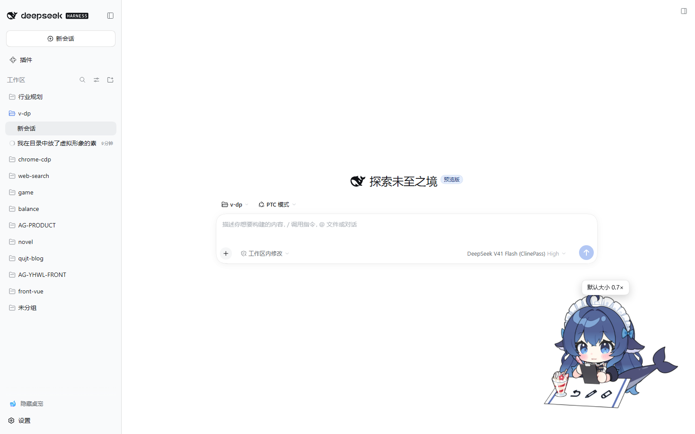
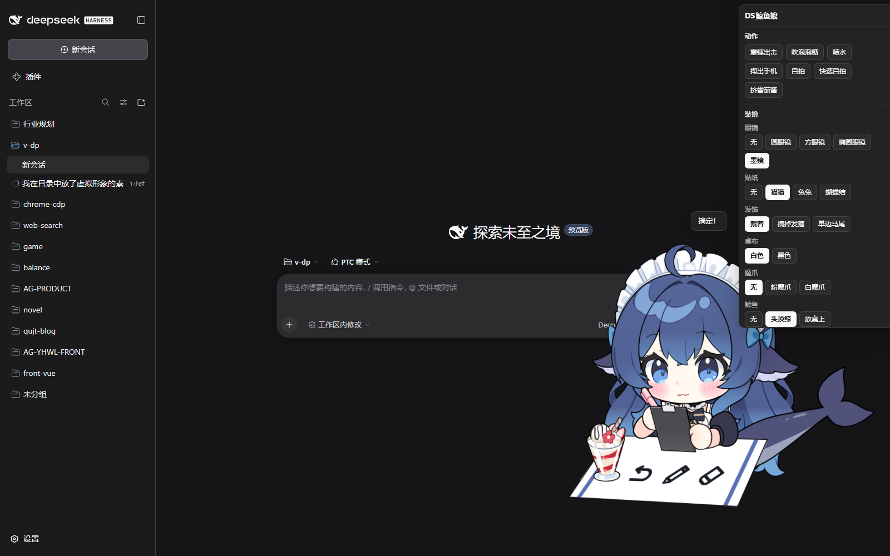

# dsh-desktop-pet

English | [简体中文](README.zh-CN.md)

A **Live2D desktop pet plugin for the DSH (DeepSeek Harness) Web GUI**: a character you can drag, that watches your cursor, gets shy when clicked, and changes motion and expression with the state of the session.

It ships with **DS Whale Girl** (8 motion groups + 44 expressions / props). Install it and refresh the page — she is there.





## Features

- **Drag / scale**: position and size are stored in `localStorage` and survive a refresh
- **Follows the cursor**: gaze and head track the pointer, and recentre when it leaves or the window loses focus
- **Click reactions**: one click swaps to a random motion / expression and pops a line; double-click plays the "happy" set
- **Click-through**: only the pixels the character actually draws take mouse events; transparent areas of the square canvas **pass through** to the page underneath, so DSH's UI is never blocked
- **Follows the session**: subscribes to DSH's real events and switches motion and expression for thinking / tool use / awaiting approval / done / failed
- **20 exclusive slots**: the 44 expressions are grouped into 20 slots by the model author's own categories (glasses / stickers / hair ornaments / tablecloth / claws / whale / desk props / right hand / selfie / left hand / eyes / mood / mouth / symbols / ambience ×3 / blush / other / menu), freely composable, with the selected option sticking
- **Follows the theme**: the panel and speech bubble use DSH's theme tokens, so light and dark both work

## Install

```bash
# The official desktop client uses the desktop profile
dsh plugin --profile desktop add "link:D:/project/qujinting/dsh-plugins/dsh-desktop-pet"

# dsh web running in a browser uses the web profile
dsh plugin --profile web add "link:D:/project/qujinting/dsh-plugins/dsh-desktop-pet"
```

After installing, **refresh the page once** (the client bundle loads when the page starts and is not hot-pushed into an already-open window).

> You can also let DSH install it: ask the agent in a conversation to call the plugin manager tool, or edit `$DSH_HOME/profiles/<profile>/package.json` directly — add `dsh-desktop-pet` to `dsh.profile.bundles` and `dependencies` (`link:` to this directory), then run `pnpm install` again.

### Cubism Core: nothing to install by hand

`live2dcubismcore.min.js` is Live2D Inc.'s **proprietary runtime** and cannot be redistributed with the plugin — but you do not have to hunt for it either. The first time it is needed, the **host half** fetches a copy from the [official Live2D CDN](https://cubism.live2d.com/sdk-web/cubismcore/live2dcubismcore.min.js) (verifying `Live2DCubismCore` before writing it), caches it at `$DSH_HOME/desktop-pet/.runtime/live2dcubismcore.min.js`, and everything works **offline** from then on.

Only a machine with **no outbound access** needs a manual step: download the [Cubism SDK for Web](https://www.live2d.com/sdk/cubism/) and put `Core/live2dcubismcore.min.js` at that same path.

When it cannot be obtained, a notice appears in the bottom-right corner and the rest of the plugin keeps working (no blank screen, no error spew).

## Using it

| Action | Effect |
|---|---|
| Drag the character | Move her (remembered locally) |
| Wheel / panel slider | Scale (0.4×–2.5×), growing upward from her feet, never off-window |
| Left click | Random motion / expression plus a line |
| Left double-click | The "happy" set (hearts / excited) |
| Right click | Open the control panel: **motion** / **outfit** / **appearance** (slider, reset, clear outfit, let go, hide) |
| Esc | Close the panel |
| Sidebar "🐋 Hide pet / Show pet" | Put her away / bring her back (directly above "Settings") |

Default size is **0.7×** (wheel or slider adjusts from 0.4× to 2.5×). **Reset** restores everything at once: default size, default corner, release the held motion, clear the outfit — while the neighbouring "clear outfit" and "let go" do only their one thing.

There is no permanent UI on the canvas; the panel appears only on right click. The single exception is the sidebar footer toggle, which is **the only way back once she is hidden**, so it has to live outside the pet (see below).

### Panel conventions

**"Held" motions stop on their last frame.** Hammer strike / selfie / quick selfie / ketchup play out and return to idle on their own (props put away too); **pulling out the phone / blowing a bubble / spraying water** are **held** motions — they stop on the last frame and the button carries a `held` tag. There are three ways to let go:

- **Click that motion again** (the label becomes `let go`);
- The panel's **let go** (releases the motion only) or **reset** (also restores position, size, outfit);
- The session phase returning to `idle` releases it automatically.

**Outfit options marked `▸` play a motion.** Pulling out the phone / selfie / quick selfie / ketchup / bubble have no expression parameters of their own — they mean "perform that motion". Clicking plays it and records the choice. **Prerequisites are added automatically**: clicking "ketchup" serves the omurice first, clicking "selfie" pulls the phone out first.

**Slots taken over by the session are still clickable.** The panel shows "the session has taken this over — click to switch to your choice", and once you click, yours wins until the phase changes; slots the phase does not name stay yours the whole time.

**The wheel scrolls on the panel, it does not scale.** The panel has its own scrollbar; the wheel only scales over the character.

## Session phases

The pet subscribes to the phase the host pushes (SSE) and changes appearance with DSH's real events:

| Phase | When | What this pet performs |
|---|---|---|
| `thinking` | The model is thinking / just started | Whale overhead + pen, "let me think…" |
| `tool` | Running a tool | On the desk + notebook + pen + sweat, "busy…" |
| `waiting` | Something **needs your approval** / an answer | Whale overhead + eraser + question mark, "needs your confirmation" |
| `done` | The turn finished (celebrates for 3.5s) | Bubble + excited + mood flowers, "done!" |
| `failed` | Something errored (shown for 5s) | On the desk + pen + crying + sweat, "aw… that failed" |

The event sources are `agent/status`, `tools/result`, `agent/error`, `approval/request`, `user-questions/request`.

**A phase takes over, it does not stack**: slots the phase names use what it rolled; slots it does **not** name **keep your own choice** (when the session ends the phase yields, and your outfit is still there). Slots a phase has taken over are marked "session in control" on the panel.

> `approval/request` and `user-questions/request` are waterfall events: the pet only **observes**, the observer is wrapped in `try`, and `next()` is called **unconditionally** afterwards — so a broken pet can never stall an approval or a question (a test watches for exactly this).

## Host HTTP endpoints

| Method | Path | Meaning |
|---|---|---|
| GET | `/api/dsh-pet/catalog` | Pet inventory + motion / expression tables + runtime URL + current phase |
| GET | `/api/dsh-pet/asset/<path>` | Serves only files inside the **reference closure** of `c_0120.model3.json` (allow-list Set comparison plus a realpath containment check; `..` never matches) |
| GET | `/api/dsh-pet/runtime/core.js` | Cubism Core: serve the local copy if present, otherwise fetch from the official CDN and cache it (`x-dsh-pet-core: cached` / `downloaded`) |
| GET | `/api/dsh-pet/runtime/vendor.js` | The plugin's bundled MIT vendor chunk (pixi.js + engine), lazy-loaded |
| GET | `/api/dsh-pet/events` | The SSE stream of session phases |

Every route **answers loopback requests only**. Assets carry an ETag, so a refresh gets a 304 instead of re-downloading 4 MB of textures.

## Architecture

```
dsh-desktop-pet/
  package.json          dsh.client.platform = web -> a dual-half package
  cordis.patch.yml      bundle patch: inserts one desktop-pet row
  lib/
    index.js            host half: pet inventory / closure asset route / Cubism Core proxy and cache /
                        vendor distribution / session phase SSE
    client.js           browser half: a hand-written __ModuleLoader__ factory, no build step
    live2d-vendor.js    the pixi.js + untitled-pixi-live2d-engine IIFE (an esbuild artefact)
  src/vendor-entry.js   vendor chunk entry (regenerate with npm run build:vendor)
  assets/pet/           the bundled pet: model + motions + expressions + the pet.json manifest
  test/                 deterministic tests for parsing / host routes / session phases
```

Neither half **imports anything from `@deepseek-ai/*`** — a profile-installed plugin cannot resolve those anyway — so the host half has zero dependencies, and the browser half uses only what the module table seeds (not even React here; it touches the DOM directly, one less layer to break).

### Why expressions are driven by the plugin

The engine's `expression()` can hold **one** expression at a time (`ExpressionManager.currentExpression` is a single value). But this model's 20 slots must hold **simultaneously** (glasses + sticker + blush + eyes…), so the plugin goes through the model's own parameters instead:

1. At startup, fetch all 44 `.exp3.json` files and parse each expression's parameter table;
2. Choose a combination → **sum the parameters by id** across the selected options to get the current look;
3. Write those parameters into the core model every frame, in `beforeModelUpdate`.

This works because **all 105 expression parameters in this model are `Blend: "Add"`** (verified by scanning them). The engine's per-frame order is "motion → `saveParameters()` → expressions → … → `beforeModelUpdate` → `model.update()` → `loadParameters()`", meaning expressions never write back to the base values, so our write position is exactly equivalent to the engine's own expression pass — except it can carry any number of expressions at once.

> **Parameters must be written by index, not by id string.** The framework's `getParameterIndex()` does not resolve bare strings: ask it for `"Paramhh2"` (real index 200) and it answers **249**, while the model has only 247 parameters — so `addParameterValueById("Paramhh2", …)` writes to a phantom slot past the end of the array and **nothing happens**. My first version did exactly that, and the whole outfit system was a silent no-op: the chip highlighted, the model did not move. Now an "id → index" table is built once and `addParameterValueByIndex()` does the writing. `status()` exposes `unresolvedLookParameters` as the readout for this class of mismatch; it should be an empty array.

### Why the canvas scales with the zoom

A WebGL canvas **clips** whatever draws outside it. A fixed-size canvas would cut the character off as soon as it grows, so the surface size follows the zoom, anchored at her **feet**, growing upward.

The "picture frame" used for fitting is the content bounding box measured once at load, multiplied by 1.25 — idle animation and props (the whale overhead, the parfait on the desk, the raised hammer) move the silhouette, and measurements showed the union over a few seconds of idling is about 8% wider than a single frame, so 1.25 is what keeps it uncut. The extra transparent margin **costs nothing**: `pointer-events` there is `none`.

### How click-through is decided

The model declares no `HitAreas`, and the engine's `containsPoint` only looks at the bounding rectangle, so the plugin approximates the silhouette itself: take each **visible drawable**'s bounding box, union them into a mask cached per frame, then use `model.toModelPosition()` to bring the pointer into the same coordinate system and point-test there. It is tight enough (measured: about 30–50% of the canvas area takes events) and needs no GPU readback at all.

## Building your own pet

The pet lives in `assets/pet/`; replace the files and you are done (path segments allow only `[A-Za-z0-9._-]` — non-ASCII filenames are rejected by the asset route):

```
assets/pet/
  pet.json             manifest: motion table / slots / phases / lines
  c_0120.model3.json   model definition (motions and expressions are declared here)
  model/               .moc3 / physics3 / cdi3
  textures/            textures
  motions/             .motion3.json
  expressions/         .exp3.json
  preview.png          plugin icon / preview image
```

- **The motion and expression lists come from what `.model3.json` declares**; the host half reads it at startup to derive the reference closure and the expression table — swapping models or adding motions takes effect immediately, with no plugin code change.
- `motions` in `pet.json` accepts `hold` (stop on the last frame), `prepend` (play a prerequisite first — the selfie needs the phone out), and `preset` (pin a few parameters before playing — the water spray needs `jingyu: 1`).
- `slots` are the exclusive slots; `options[].expressions` may list several ("white claws" = pink claws + recolour).
- `phases` declares which slots each phase names, which motion it plays, and what it says.

> **"Play once" has to be stated explicitly.** **Every** `.motion3.json` in this model writes `"Loop": true` in its own `Meta` — even one-shot motions like hammer strike / selfie / pulling out the phone / water spray. The engine only overrides that when `loop` is passed explicitly, so the plugin passes `loop: false` for every non-`hold` motion; otherwise one click leaves the hammer swinging forever (this was actually hit). `Idle` keeps looping, which is exactly what it should do.

> **Props have to be put away.** A motion only drives the parameters it writes, and the engine stores each frame's motion output as the next frame's baseline — the idle motion never touches `Param71` (the hammer appearing), so after a swing the hammer just stays on screen. Measured: seven seconds after a one-shot motion finishes, hammer strike leaves 4 parameters off their idle values, quick selfie 6, ketchup 13. The plugin restores every parameter to the author's defaults when the motion ends, which is what "back to idle" actually requires.
>
> Triggering that restore **cannot use the engine's `onFinish`** — it accepts the option and then drops it in `_startMotion(motion, void 0, …)`, so the callback never arrives. Use the motion manager's own `motionFinish` event instead (idle loops, so it never fires for idle).

## Development

```bash
npm install            # pixi.js / engine / esbuild
npm run build:vendor   # after changing src/vendor-entry.js or upgrading dependencies
npm test               # parsing + host routes + session phases (all offline, no browser needed)
```

`npm test` covers:

- **Parsing**: both halves go through a real JS parser, plus a check of the `__ModuleLoader__` factory contract (`node --check` is not enough here — it reports "two statements on one line" as a baffling "private field must be declared in an enclosing class");
- **Host routes**: inventory, reference closure (including `..` / `%2e%2e` traversal), ETag 304, vendor, Cubism Core download and cache, the first SSE frame, method restrictions;
- **Session phases**: driven by the real event names, verifying each phase, the automatic fall-back of short-lived phases, and that **the waterfall observer always calls `next()`** (even when it throws itself).

After changing `lib/client.js`, just **refresh the page** (the host derives a new rev from mtime/size and the browser fetches the new bundle). After changing `lib/index.js` (the host half) you must **restart DSH** — Node caches modules it has already loaded, and remounting the plugin does not re-import it.

Changes under `assets/pet/` need **no restart**: the host half compares the mtime/size of `pet.json` and the model definition to decide whether its cache is stale, so refresh after editing.

The debug readout hangs off `window.__dshDesktopPet`: `status()` (phase / zoom / per-slot selection / current look parameters), `hitAt(x, y)` (does a screen coordinate take events), `model()`, `root()`.

### If the pet does not show up

**Failures explain themselves.** When mounting fails:

- A notice in the bottom-right corner: **the first line is the cause, the second the concrete exception** (`stage: message`) — a screenshot is enough to locate it;
- The same record is written to `localStorage` under `dsh-desktop-pet.last-error` (with the `cause` chain, uncaught errors, UA, stack), survives a refresh, and is cleared automatically once mounting succeeds;
- The full text is also at `window.__dshDesktopPetError`.

The `closure` field of `GET /api/dsh-pet/catalog` is a diagnostic snapshot of the reference closure: `{ size, rebuilds, misses, healed }`. `misses` counts requests for paths outside the closure, and `healed` counts how many of those were **found after recomputing the closure** — normally `healed` should be 0.

> Why recompute on a miss: the closure is **derived data** inferred from the model's own references, and a miss is precisely the one moment worth recomputing. This used to answer 404 directly, so a texture the model needed and that really existed on disk got rejected, and the pet sat at "model failed to load". Now a miss first confirms the file really is inside the pet directory, then recomputes once; **the allow list is not widened** — recomputation only honours what the model references, and a file that exists but is not referenced still 404s (tests watch both).
>
> Separately, the model is assembled from six or seven requests (definition / moc / physics / two textures / motions), and any one of them failing used to leave the pet **broken until the page was refreshed**; now it retries once after 0.9s and only then reports an error.

### Two traps that only appear in the desktop client (both fixed)

The desktop client serves the GUI under a custom protocol, **`dsh-app://app`** (not `http://127.0.0.1:19387`), so what works in `dsh web` does not necessarily work here. Two were hit, and both are worth writing down:

**1. Every URL handed to the engine must be absolute.** The engine resolves model references with its own `resolveURL`: if the model URL is **root-relative** (`/api/...`), the texture URLs it derives are root-relative too, and pixi hands textures to a **blob worker** for decoding whose base is `blob:dsh-app://app/<uuid>`. A root-relative path resolves against that base as `dsh-app://api/dsh-pet/...` — **the host is eaten**, the protocol handler does not recognise `app`, and it 404s. The same code resolves to `http://127.0.0.1:19387/api/...` under `http://`, which is why everything worked in the browser and only the desktop broke. Fix: the client turns every URL it hands to the engine into an absolute one with `new URL(path, location.href)`.

**2. The vendor chunk must not re-execute when the client reloads.** HMR re-runs `apply()` every time it replaces `lib/client.js`; the old code re-inserted the 800 KB vendor `<script>` each time, **building another Cubism framework** while Cubism Core is a page-level singleton — repeated `startUp` + `initialize` blows up its WebAssembly table with `Unable to grow wasm table`, which looks like "I touched the plugin and the pet died". Fix: reuse the vendor chunk if it has already loaded, never re-execute it.

Both traps were found through the `pageUrl` / `baseURI` / `catalogModel` / `modelSource` / `workerUrls` fields in the failure record — a bare "404" does not tell you the host was eaten.

### How to verify "this button actually works"

**Do not verify your own ledger; verify the model.** My first version checked outfits by reading the plugin's own computed `lookParameters` ("the parameter table contains this entry"), which is exactly how the silent no-op above slipped through — the ledger was perfect and the model never moved. Every slot is now verified by reading **the model's real parameter values** in `beforeModelUpdate`, and confirming that "at least one of the parameters this option declares actually moved":

```js
pet.model.internalModel.on('beforeModelUpdate', () => {
  live = { hh2: core.getParameterValueByIndex(idx.Paramhh2) }
})
// sample a few frames before / after clicking "blush", take the median, then compare
```

Passing means `diag.status().unresolvedLookParameters` is empty **and** every slot has a parameter that really moved.

### How to get her back after hiding

"Hiding" is **persisted**, so "how to bring her back" cannot live only inside the thing being hidden — the panel itself is inside the hidden node, and once you press "hide" it is out of reach (my first version made this mistake and genuinely locked the user out). There is now a permanent **🐋 Hide pet / Show pet** toggle in the sidebar footer, directly above "Settings", using the official `sidebar.footer.action` extension point; the pet panel's "hide" shares the same state, synchronised both ways.

If you are somehow still stuck (an older version, say): open DevTools with **F12** and run this in the Console

```js
const k = 'dsh-desktop-pet.state.v1'
const s = JSON.parse(localStorage.getItem(k) || '{}')
delete s.hidden
localStorage.setItem(k, JSON.stringify(s))
location.reload()
```

That clears only `hidden`; position / size / outfit are kept. `Ctrl+R` alone will not work — the hidden state is persistent, so a refresh comes back hidden too.

## License

- Plugin code: **MIT** (see [LICENSE](LICENSE))
- Vendored chunk: pixi.js (MIT) + untitled-pixi-live2d-engine (MIT), redistributable
- **The DS Whale Girl model** (`assets/pet/`, `icon.png`): **CC BY-NC-SA 4.0** — attribution · **non-commercial** · share-alike, see [`assets/pet/LICENSE`](assets/pet/LICENSE)
- Cubism Core: proprietary to Live2D, **not redistributed**

Copyright chain: **上善无形** (original character author, the OC "溟月") → **ZipZipPipe** (DeepSeek maid derivative) → **氵六青** (this model). The model author has authorised redistribution with this plugin, but that authorisation **does not lift the underlying copyright**, so **NC / SA still apply**; commercial use requires permission from all three. Full details in [NOTICE.md](NOTICE.md).
