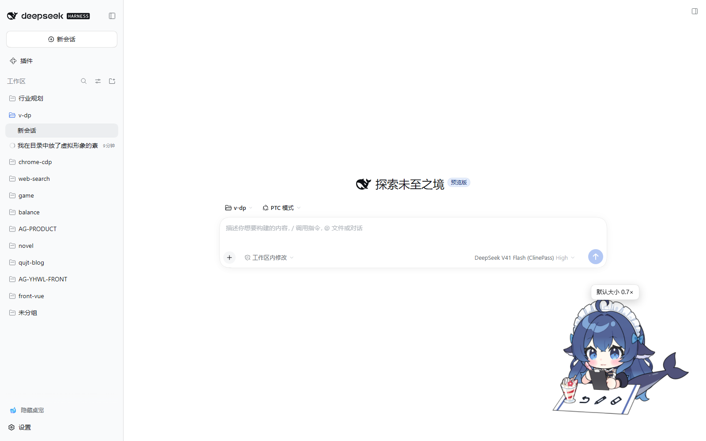
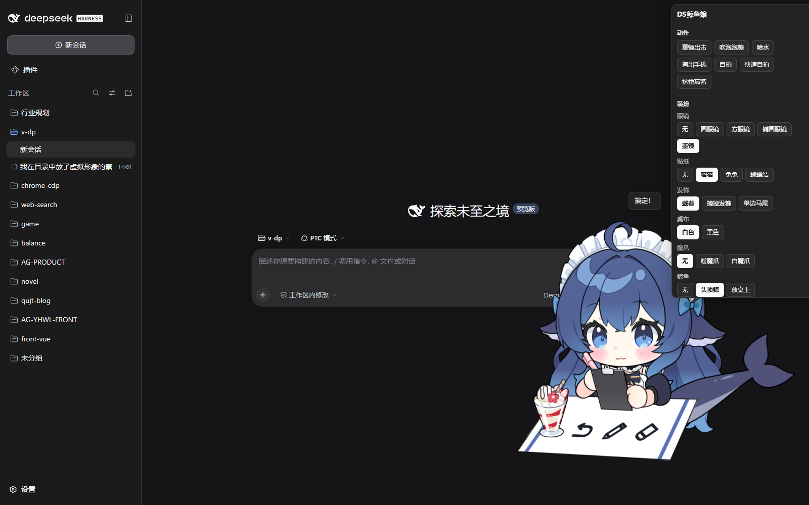

# dsh-desktop-pet

[English](README.md) | 简体中文

给 **DSH**（DeepSeek Harness）Web GUI 用的 **Live2D 桌宠插件**：一只可以拖动、
跟着鼠标看、点她会害羞、还会跟着会话状态换动作与表情的桌宠。

自带 **DS鲸鱼娘**（8 组动作 + 44 个表情 / 道具），装完刷新页面就能看见。





## 功能

- **拖动 / 缩放**：位置和大小记在 `localStorage`，刷新还在
- **跟随鼠标**：视线和头部跟着指针走，指针离开或窗口失焦自动回正
- **点击反应**：点一下随机换动作 / 表情并弹一句台词，双击是「开心」那套
- **事件穿透**：只有**角色真正画出来的地方**吃鼠标事件，方形画布的透明处**穿透**到
  底下的页面，不挡 DSH 的 UI
- **跟着会话走**：订阅 DSH 的真实事件，思考 / 用工具 / 等你确认 / 完成 / 出错换动作与表情
- **20 个互斥槽位**：44 个表情按模型作者自己的分组归成 20 个槽位（眼镜 / 贴纸 / 发饰 /
  桌布 / 魔爪 / 鲸鱼 / 桌面摆设 / 右手 / 自拍 / 左手 / 眼部 / 情绪 / 嘴部 / 符号 /
  氛围 ×3 / 脸红 / 其他 / 点菜），可任意组合，选中的槽位常驻
- **跟着主题走**：面板与气泡用 DSH 的主题 token，浅色 / 深色都对

## 安装

```bash
# 官方桌面客户端用的是 desktop profile
dsh plugin --profile desktop add "link:D:/project/qujinting/dsh-plugins/dsh-desktop-pet"

# 浏览器里跑的 dsh web 用的是 web profile
dsh plugin --profile web add "link:D:/project/qujinting/dsh-plugins/dsh-desktop-pet"
```

装完**刷新一次页面**（客户端 bundle 在页面启动时加载，不会自动热更到已打开的窗口）。

> 也可以让 DSH 自己装：在对话里让 agent 调用插件管理工具，或直接编辑
> `$DSH_HOME/profiles/<profile>/package.json`，把 `dsh-desktop-pet` 加进
> `dsh.profile.bundles` 与 `dependencies`（`link:` 到本目录），再跑一次
> `pnpm install`。

### Cubism Core：不用手动装

`live2dcubismcore.min.js` 是 Live2D 株式会社的**专有运行时**，不能随插件分发 ——
但你也不用自己去找：第一次用到它时，**宿主半区**会去
[Live2D 官方 CDN](https://cubism.live2d.com/sdk-web/cubismcore/live2dcubismcore.min.js)
取一份（校验过 `Live2DCubismCore` 再落盘），缓存到
`$DSH_HOME/desktop-pet/.runtime/live2dcubismcore.min.js`，之后**离线也能用**。

只有这台机器**访问不了外网**时，才需要手动下载
[Cubism SDK for Web](https://www.live2d.com/sdk/cubism/)、把
`Core/live2dcubismcore.min.js` 放到上面那个路径。

拿不到时页面右下角会弹一条提示，插件其余部分照常工作（不会白屏、不会报错刷屏）。

## 怎么用

| 操作 | 效果 |
|---|---|
| 拖动角色 | 移动位置（记在本地） |
| 滚轮 / 面板滑杆 | 缩放（0.4×–2.5×），从脚底往上长，不会跑出窗口 |
| 左键点一下 | 随机动作 / 表情 + 一句台词 |
| 左键双击 | 「开心」那套（冒爱心 / 开心兴奋） |
| 右键 | 打开控制面板：**动作** / **装扮** / **外观**（滑杆、复位、清空装扮、松手、隐藏） |
| Esc | 关掉面板 |
| 侧栏「🐋 隐藏桌宠 / 显示桌宠」 | 收起 / 唤回桌宠（在「设置」正上方） |

默认大小是 **0.7×**（滚轮或滑杆可在 0.4×–2.5× 之间调）。**复位**一个按钮把一切还原：
默认大小、默认角落、放开定格动作、清空装扮 —— 旁边的「清空装扮」「松手」只做其中一件。

画面上没有常驻 UI，面板只在右键时出现 —— 唯一的例外是侧栏脚部那个开关，它是**隐藏之后
唯一能把她叫回来的入口**，所以必须留在桌宠之外（见下）。

### 面板里的几个约定

**「定格」动作会停在最后一帧。** 重锤出击 / 自拍 / 快速自拍 / 挤番茄酱播完会自己回到待机
（道具也收掉）；**掏出手机 / 吹泡泡糖 / 喷水**是**定格**动作 —— 停在最后一帧，按钮上带一个
`定格` 小标。放手有三种方式：

- **再点一次那个动作**（标签会变成 `放手`）；
- 面板底部的 **松手**（只放开动作）或 **复位**（连位置大小装扮一起还原）；
- 会话相位回到 `idle` 时自动放手。

**带 `▸` 的装扮选项会播一段动作。** 掏出手机 / 自拍 / 快速自拍 / 挤番茄酱 / 吹泡泡糖这几个
选项本身没有表情参数，它们的含义就是「演那段动作」—— 点下去会播动作，同时记下这个选择。
**前提会自动补上**：点「挤番茄酱」会先把「蛋包饭」端上来，点「自拍」会先把手机掏出来。

**被会话接管的槽位也能点。** 面板会标一行「会话接管中 —— 点一下可以临时改成你选的」，
点了就以你的为准，直到相位切换；相位没点名的槽位一直是你的。

**滚轮在面板上是滚动，不是缩放。** 面板有自己的滚动条，滚轮只在角色身上才缩放。

## 会话相位

宠物订阅宿主推来的相位（SSE），跟着 DSH 的真实事件换样子：

| 相位 | 什么时候 | 这只宠物演什么 |
|---|---|---|
| `thinking` | 模型在想 / 刚开工 | 头顶鲸 + 画笔，「让我想想…」 |
| `tool` | 调工具 | 放桌上 + 写本本 + 画笔 + 流汗，「正在忙…」 |
| `waiting` | 有操作**等你批准** / 等你回答 | 头顶鲸 + 橡皮 + 问号，「需要你确认一下」 |
| `done` | 这一轮说完（庆祝 3.5 秒） | 吹泡泡糖 + 开心兴奋 + 情绪花花，「搞定！」 |
| `failed` | 出错了（显示 5 秒） | 放桌上 + 画笔 + 大哭 + 流汗，「呜…出错了」 |

事件来源是 `agent/status`、`tools/result`、`agent/error`、`approval/request`、
`user-questions/request`。

**相位是「接管」，不是「叠加」**：相位点名的槽位用它抽到的；相位**没**点名的槽位
**保持你自己的选择**（会话结束后相位让位，你原来挑的装扮还在）。面板上被相位接管的
槽位会标一行「会话接管中」。

> `approval/request` 与 `user-questions/request` 是 waterfall 事件：宠物只**观察**，
> 观察函数整体包在 `try` 里、之后**无条件**调用 `next()`，所以桌宠出问题也绝不会
> 卡住审批或提问（有测试盯着这条）。

## 宿主 HTTP 接口

| 方法 | 路径 | 说明 |
|---|---|---|
| GET | `/api/dsh-pet/catalog` | 宠物清单 + 动作 / 表情表 + 运行时 URL + 当前相位 |
| GET | `/api/dsh-pet/asset/<path>` | 只服务 `c_0120.model3.json` **引用闭包**内的文件（白名单 Set 比对 + realpath 包含，`..` 永远匹配不上） |
| GET | `/api/dsh-pet/runtime/core.js` | Cubism Core：本地有就发本地的，没有就去官方 CDN 取一份并缓存（`x-dsh-pet-core: cached` / `downloaded`） |
| GET | `/api/dsh-pet/runtime/vendor.js` | 插件内置的 MIT vendor 分包（pixi.js + 引擎），按需懒加载 |
| GET | `/api/dsh-pet/events` | 会话相位的 SSE 流 |

所有路由**只答本机回环请求**。资产带 ETag，刷新走 304，不会重下 4 MB 贴图。

## 架构

```
dsh-desktop-pet/
  package.json          dsh.client.platform = web -> 双半区包
  cordis.patch.yml      bundle patch：插一行 desktop-pet
  lib/
    index.js            宿主半区：宠物清单 / 引用闭包资产路由 / Cubism Core 代理与缓存 /
                        vendor 分发 / 会话相位 SSE
    client.js           浏览器半区：手写 __ModuleLoader__ 工厂，无构建步骤
    live2d-vendor.js    pixi.js + untitled-pixi-live2d-engine 的 IIFE（esbuild 产物）
  src/vendor-entry.js   vendor 分包入口（npm run build:vendor 重新生成）
  assets/pet/           随包的宠物：模型 + 动作 + 表情 + pet.json 清单
  test/                 解析 / 宿主路由 / 会话相位的确定性测试
```

两个半区都**不 import 任何 `@deepseek-ai/*`** —— profile 里装的插件本来就解析不到，
所以宿主半区零依赖，浏览器半区只用了模块表里种下的东西（这里连 React 都没用，
直接操作 DOM，少一层出错的地方）。

### 为什么表情要自己驱动

引擎的 `expression()` 一次只能挂**一个**表情（`ExpressionManager.currentExpression`
是单值）。而这只模型的 20 个槽位是要**同时**成立的（眼镜 + 贴纸 + 脸红 + 眼部…），
所以插件走的是模型自己的参数：

1. 启动时把 44 个 `.exp3.json` 全取下来，解析出每个表情的参数表；
2. 选中组合 → 把各槽位选中项的参数**按 id 相加**，得到当前 look；
3. 每帧在 `beforeModelUpdate` 里把这些参数写进核心模型。

这之所以成立，是因为**这只模型的 105 个表情参数全部是 `Blend: "Add"`**（扫过一遍确认）。
引擎每帧的顺序是「运动 → `saveParameters()` → 表情 → … → `beforeModelUpdate` →
`model.update()` → `loadParameters()`」，也就是说表情本来就不写回基准值，我们的写入
位置和引擎自己的表情 pass 完全等价，只是能一次带任意多个表情。

> **写参数必须走 index，不能用 id 字符串。** 框架的 `getParameterIndex()` 不解析裸字符串：
> 问它 `"Paramhh2"`（真实下标 200）它答 **249**，而模型只有 247 个参数 —— 于是
> `addParameterValueById("Paramhh2", …)` 写进了一个数组外的幽灵位置，**什么都不发生**。
> 我第一版就是这么写的，结果整个装扮系统是个静默空操作：chip 高亮、模型纹丝不动。
> 现在先建一次「id → 下标」表，再用 `addParameterValueByIndex()` 写。
> `status()` 里的 `unresolvedLookParameters` 就是给这类不匹配留的读数，正常应该是空数组。

### 为什么画布会跟着缩放变

WebGL 画布会**裁掉**画到自己外面的东西。固定尺寸的画布一旦放大就会把角色切掉，所以
surface 的尺寸跟着缩放走，并且以**脚底**为锚点，放大时往上长。

贴合用的「画框」是加载时量一次的内容包围盒，再乘 1.25 —— 待机动画和道具（头顶鲸、
桌上的巴菲、挥起来的锤子）会让轮廓动，实测几秒待机的并集比单帧宽约 8%，留 1.25 倍
才不会被切。多出来的透明边**不要钱**：那里的 `pointer-events` 是 `none`。

### 事件穿透是怎么判的

模型没有声明 `HitAreas`，引擎的 `containsPoint` 又只看包围矩形，所以轮廓是插件自己
近似的：取所有**可见 drawable** 各自的包围盒，并成一张每帧缓存的遮罩，再用
`model.toModelPosition()` 把指针换算到同一坐标系里做点测试。够紧（实测约 30–50% 的
画布面积吃事件），又完全不用做 GPU 回读。

## 做一只自己的宠物

宠物就在 `assets/pet/`，直接换掉里面的文件即可（路径片段只允许 `[A-Za-z0-9._-]`，
中文文件名会在资产路由上被挡掉）：

```
assets/pet/
  pet.json             清单：动作表 / 槽位 / 相位 / 台词
  c_0120.model3.json   模型定义（动作与表情都在这里声明）
  model/               .moc3 / physics3 / cdi3
  textures/            贴图
  motions/             .motion3.json
  expressions/         .exp3.json
  preview.png          插件图标 / 预览图
```

- **动作与表情列表以 `.model3.json` 里声明的为准**，宿主半区启动时读它算出引用闭包和
  表情表 —— 换模型 / 加动作立刻生效，不用改插件代码。
- `pet.json` 里的 `motions` 用 `hold`（停在最后一帧）、`prepend`（先播前置动作，
  自拍要先把手机掏出来）、`preset`（开播前钉住几个参数，喷水要 `jingyu: 1`）。
- `slots` 就是互斥槽位，`options[].expressions` 可以写多个（「白魔爪」= 粉魔爪 + 换色）。
- `phases` 写每个相位点名哪些槽位、播什么动作、说什么。

> **「播一次」这件事得自己说。** 这只模型的**每个** `.motion3.json` 都在自己的 `Meta` 里
> 写了 `"Loop": true` —— 连 重锤出击 / 自拍 / 掏出手机 / 喷水 这些一次性动作也是。引擎只在
> 显式传了 `loop` 时才覆盖它，所以插件对非 `hold` 的动作一律传 `loop: false`；否则点她一下，
> 锤子就永远停不下来（真踩过）。`Idle` 保持循环，那正是它该有的行为。

> **道具要自己收。** motion 只驱动它写到的参数，而引擎会把每帧 motion 的输出存成下一帧的
> 基准 —— 待机动作不碰 `Param71`（锤子出现），所以抡完锤子它就一直在画面上。实测：一次性
> 动作播完 7 秒后，重锤出击留下 4 个偏离待机的参数、快速自拍 6 个、挤番茄酱 13 个。插件在
> 动作结束时把全部参数还原成作者默认值，才真正「回到待机」。
>
> 触发这个还原**不能用引擎的 `onFinish`** —— 它收了这个选项，然后在
> `_startMotion(motion, void 0, …)` 里把它丢了，回调永远不会来。要用动作管理器自己的
> `motionFinish` 事件（待机是循环的，不会触发它）。

## 开发

```bash
npm install            # pixi.js / engine / esbuild
npm run build:vendor   # 改了 src/vendor-entry.js 或升级依赖时
npm test               # 解析 + 宿主路由 + 会话相位（全部离线，不需要浏览器）
```

`npm test` 覆盖：

- **解析**：两个半区都用真实 JS parser 过一遍，并检查 `__ModuleLoader__` 工厂契约
  （`node --check` 在这里不够用 —— 它会把「两条语句挤在一行」报成莫名其妙的
  "private field must be declared in an enclosing class"）；
- **宿主路由**：清单、引用闭包（含 `..` / `%2e%2e` 穿越）、ETag 304、vendor、Cubism
  Core 的下载与缓存、SSE 首帧、方法限制；
- **会话相位**：按真实事件名驱动，验证每个相位、短暂相位的自动回落，以及
  **waterfall 观察者一定会 `next()`**（哪怕它自己炸了）。

改了 `lib/client.js` 之后**刷新页面**即可（宿主按 mtime/size 生成新 rev，浏览器取到的是新包）；
改了 `lib/index.js`（宿主半区）需要**重启 DSH** —— Node 会缓存已经加载过的模块，重挂插件
不会重新 import 它。

改 `assets/pet/` 下的东西**不用重启**：宿主半区按 `pet.json` 与模型定义的 mtime/size
判断缓存是否过期，改完刷新页面就能看见。

调试读口挂在 `window.__dshDesktopPet`：`status()`（相位 / 缩放 / 各槽位选择 / 当前
look 参数）、`hitAt(x, y)`（某个屏幕坐标吃不吃事件）、`model()`、`root()`。

### 桌宠没出来怎么办

**失败会自己说清楚。** 挂载失败时：

- 右下角弹一条提示：**第一行是原因，第二行是具体异常**（`阶段: 消息`），截个图就够定位；
- 同一份记录写进 `localStorage` 的 `dsh-desktop-pet.last-error`（含 `cause` 链、
  未捕获异常、UA、栈），刷新后还在，挂载成功时自动清掉；
- 完整文本同时在 `window.__dshDesktopPetError`。

`GET /api/dsh-pet/catalog` 的 `closure` 字段是引用闭包的诊断快照：
`{ size, rebuilds, misses, healed }`。`misses` 是「请求了闭包里没有的路径」的次数，
`healed` 是其中**重算闭包后又找到了**的次数 —— 正常情况下 `healed` 应该是 0。

> 为什么查不到要重算：闭包是从模型自己的引用推出来的**派生数据**，而「查不到」正是唯一
> 值得重算的时机。以前这里直接答 404，结果模型需要、磁盘上也确实存在的贴图被拒掉，桌宠就
> 卡在「模型加载失败」。现在查不到时会先确认这确实是宠物目录里的真实文件，再重算一次；
> **白名单并没有被放宽** —— 重算只认模型引用到的东西，「存在但没被引用」的文件照样 404
> （有测试盯着这两条）。
>
> 另外，模型是分六七个请求拼出来的（定义 / moc / physics / 两张贴图 / 动作），任何一个
> 掉链子以前都会让桌宠**一直坏到刷新页面为止**；现在会隔 0.9 秒重试一次，失败才报错。

### 两个只在桌面客户端出现的坑（都已修）

桌面客户端把 GUI 放在自定义协议 **`dsh-app://app`** 下（不是 `http://127.0.0.1:19387`），
`dsh web` 里能跑的东西在这里不一定能跑。踩到两个，都值得写下来：

**1. 交给引擎的 URL 必须是绝对 URL。** 引擎解析模型引用用的是一段自己写的 `resolveURL`：
模型 URL 如果是**根相对**的（`/api/...`），它推导出来的贴图 URL 也是根相对的；而 pixi 把贴图
交给一个 **blob worker** 去解码，worker 的 base 是 `blob:dsh-app://app/<uuid>`。根相对路径在
那个 base 下解析出来是 `dsh-app://api/dsh-pet/...` —— **host 被吃掉了**，协议处理器认不出
`app`，直接 404。同一段代码在 `http://` 下解析成 `http://127.0.0.1:19387/api/...`，所以浏览器
里一切正常，只有桌面端挂。修法：客户端把每个交给引擎的 URL 都先
`new URL(path, location.href)` 变成绝对 URL。

**2. vendor 分包不能跟着客户端重载重新执行。** HMR 每次替换 `lib/client.js` 都会重跑
`apply()`；以前每次都重新 `<script>` 一次那 800 KB 的 vendor 包，于是**又建一个新的 Cubism
framework**，而 Cubism Core 是页面级单例 —— 反复 `startUp` + `initialize` 会把它的
WebAssembly 表撑爆，报 `Unable to grow wasm table`，表现就是「改一下插件，桌宠就死了」。
修法：vendor 已经加载过就直接复用，不再重新执行。

找到这两个坑靠的是失败记录里的 `pageUrl` / `baseURI` / `catalogModel` / `modelSource` /
`workerUrls` —— 光看一句「404」是看不出 host 被吃掉的。

### 怎么验「一个按钮真的有用」

**别验自己的账本，验模型。** 我第一版验证装扮时读的是插件自己算出来的 `lookParameters`
（「参数表里有这一项」），于是漏掉了上面那个静默空操作 —— 账本全对，模型没动。
现在每个槽位的验证都要在 `beforeModelUpdate` 里读**模型真正的参数值**，并确认
「这个选项声明的参数里，至少有一个真的动了」：

```js
pet.model.internalModel.on('beforeModelUpdate', () => {
  live = { hh2: core.getParameterValueByIndex(idx.Paramhh2) }
})
// 点「脸红」前 / 后各采几帧取中位数，然后比对
```

`diag.status().unresolvedLookParameters` 为空 + 每个槽位都有参数真的移动，才算过。

### 隐藏之后怎么找回来

「隐藏」是**持久化**的，所以「怎么唤回」不能只放在被隐藏的那个东西里 —— 面板本身也在
被隐藏的节点里，点完「隐藏」就再也够不着了（这是我第一版犯的错，真把用户关在外面）。
现在侧栏脚部、「设置」正上方常驻一个 **🐋 隐藏桌宠 / 显示桌宠** 开关，走的是
`sidebar.footer.action` 这个官方扩展位；桌宠面板里的「隐藏」和它是同一份状态，两边随时同步。

万一还是被困住了（比如装了更早的版本）：**F12** 打开 DevTools，在 Console 里跑

```js
const k = 'dsh-desktop-pet.state.v1'
const s = JSON.parse(localStorage.getItem(k) || '{}')
delete s.hidden
localStorage.setItem(k, JSON.stringify(s))
location.reload()
```

这只清掉 `hidden`，位置 / 大小 / 装扮都留着。`Ctrl+R` 单独用不行 —— 隐藏状态是持久的，
刷新回来还是隐藏的。

## 许可

- 插件代码：**MIT**（见 [LICENSE](LICENSE)）
- vendor 分包：pixi.js（MIT）+ untitled-pixi-live2d-engine（MIT），可随包分发
- **DS鲸鱼娘模型**（`assets/pet/`、`icon.png`）：**CC BY-NC-SA 4.0**
  —— 署名 · **非商业** · 相同方式共享，见 [`assets/pet/LICENSE`](assets/pet/LICENSE)
- Cubism Core：Live2D 专有，**不随包分发**

版权链：**上善无形**（鲸鱼娘角色原作，原创 OC「溟月」）→ **ZipZipPipe**（DeepSeek
女仆二创）→ **氵六青**（本模型）。模型作者已授权本插件转载，但该授权**不解除基础
版权**，所以 **NC / SA 依然有效**；商业使用需分别取得三人授权。
完整说明见 [NOTICE.md](NOTICE.md)。
